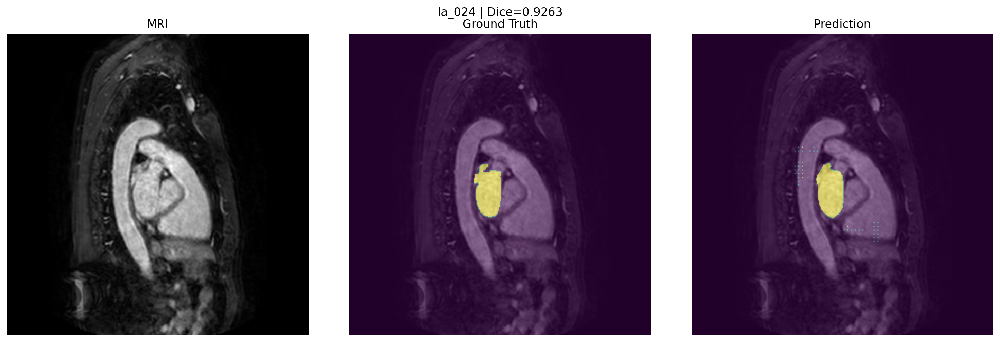

# 3D Cardiac MRI Segmentation

**Research-oriented, two-class left-atrium segmentation with PyTorch and MONAI.**

This repository contains Python source for loading cardiac MRI NIfTI volumes, applying volumetric transforms, training a 3D U-Net, performing sliding-window inference, and visualizing predictions on the **Medical Segmentation Decathlon (MSD) Task02 Heart** dataset.

> **Evidence boundary:** The best validation Dice of **0.8821** (epoch **92**) is recorded in the [project's author-generated training summary](results/training_summary.txt). It has not been independently reproduced in this audit. There is no claim of clinical validation, external generalizability, or readiness for diagnosis or treatment.

## Scope: what this model segments

The [model definition](src/model.py) uses **one input channel and two output classes**: **background** and **left atrium**. This repository does **not** substantiate claims that this specific training run segmented left/right ventricles, myocardium, or that it trained UNETR or Swin UNETR models.

The dataset is not redistributed with this repository. Obtain MSD Task02 Heart from an authorized source and follow its usage terms.

## Architecture and workflow

| Component | Source | Current documented configuration |
| --- | --- | --- |
| Data and split | [src/dataset.py](src/dataset.py) | Filename-matched NIfTI image/label pairs; deterministic shuffled split with seed 42; first 16 pairs train, remaining pairs validation |
| Input transformations | [src/dataset.py](src/dataset.py) | RAS orientation, 1.25 mm isotropic spacing, nonzero intensity normalization, random positive/negative label-centered training crops |
| Model | [src/model.py](src/model.py) | MONAI 3D U-Net with channels (16,32,64,128,256), strides (2,2,2,2), 2 residual units |
| Training | [src/train.py](src/train.py) | AdamW, DiceCELoss, nominal 100 epochs, mini-batch size 1, configured patch (128,128,96) |
| Evaluation | [src/train.py](src/train.py) | Sliding-window validation inference, DiceMetric excluding background; best checkpoint saved when the observed Dice improves |
| Inference | [src/inference.py](src/inference.py) | Loads the best checkpoint and predicts the specifically configured `la_024.nii.gz` example |
| Visualization | [src/visualize.py](src/visualize.py) | Builds a three-panel MRI/label/prediction plot |

The [YAML configuration](configs/config.yaml) documents the nominal hyperparameters. The evaluation score is tied to the original, unarchived environment and is **not** established as reproducible simply because scripts are public.

## Repository layout

```text
configs/config.yaml       experiment configuration
src/dataset.py            data loading and split
src/model.py              MONAI 3D U-Net
src/train.py              training and validation
src/inference.py          single-case inference
src/visualize.py          example plot
results/training_summary.txt  author-reported run summary
results/figures/         example image
```

The original training summary lists an **NVIDIA RTX 4070 Laptop GPU**. This information is author-recorded provenance, not independent run verification.

## Reproducing the workflow (for users with permitted data and compute)

The following commands are documentation for researchers running the project themselves; **they have not been executed as part of this audit**. Set up a compatible isolated Python environment and read the requirements before use.

1. Obtain the MSD Task02 Heart dataset under its original terms, with matched files at `data/Task02_Heart/imagesTr/*.nii.gz` and `data/Task02_Heart/labelsTr/*.nii.gz`. The current split function requires at least 17 paired cases and rejects missing or mismatched names.
2. From the repository root, install dependencies from `requirements.txt` into your chosen environment.
3. Run `python src/train.py` after checking the configuration and available GPU memory. The script creates `checkpoints/best_model.pth` as needed.
4. Run `python src/inference.py` only after a compatible, **trusted** checkpoint exists and its hardcoded `la_024.nii.gz` input is available. Then `python src/visualize.py` for the figure.

**Important:** The requirements are not pinned to independently verified versions, and the committed repository contains neither the original MRI dataset nor a published validated checkpoint. PyTorch checkpoint deserialization must not be performed on untrusted files. Hardware, MONAI/PyTorch versions, paths and available memory can affect run success.

## Results and interpretation

| Item | What is actually documented |
| --- | --- |
| Best validation Dice | **0.8821**, reported by the project author |
| Best epoch | **92**, according to [results/training_summary.txt](results/training_summary.txt) |
| Training configuration | Nominal 100 epochs, AdamW, DiceCELoss, mixed precision |
| External test cohort / clinical evaluation | **Not established** |
| Independent reproduction of original score | **Not established** |
| Original model checkpoint and full per-case predictions | **Not included in the audited repository** |



The figure is an author-provided project artifact, **not** proof of clinical correctness or an independently reviewed external benchmark.

## Reproducibility and scientific gaps

Before promoting the Dice score as a comparable research result, the repository needs:

- A versioned model/checkpoint and dataset source **without redistributing any unauthorized patient material**.
- A stable case-level split manifest with data identifiers, a documented split method, and an assessment of leakage at the patient/study level.
- Version-pinned software and environment metadata, random seeds, hardware details, model configuration and training command.
- A validation script and per-case results that a third party can run; ideally an independent external dataset and a strong conventional baseline.
- Inspection of image/label matching, spacing, orientation, output-affine consistency and class definitions.
- Proper license determination for original source code, third-party dependencies, annotations and example figures, plus disclosure of material AI assistance and human contribution roles.

**Do not interpret the absence of observed train/validation overlap as proof of leakage-free patient-level evaluation.** This code pairs files by name and uses a shuffled case-level split; patient/group independence has not been independently established.

## Responsible use and licensing

This is **experimental research software**, not a medical device or clinical decision-support tool. Use only properly authorized, de-identified research data. Avoid publishing identifiable images, patient IDs, or private medical records. Generated masks require qualified validation for any consequential use.

No root license file was present in the audited repository inventory. **No permission to reuse or redistribute the original code is implied by public GitHub access.** The copyright holder must choose and approve any project license; third-party datasets/models may have separate terms.

## Related work

- [Public technical and research profile](https://github.com/aradmanamnaoon/aradmanamnaoon/blob/main/RESEARCH_PROFILE.md)
- [CohortSeal — patient/group split integrity](https://github.com/aradmanamnaoon/cohortseal)
- [Portfolio case study](https://aradmanamnaoon.github.io/projects/3d-cardiac-mri-segmentation/)

*Documentation audit updated 2026-10-16. Source-linked behavior is distinguished from author-reported experimental outcomes.*
